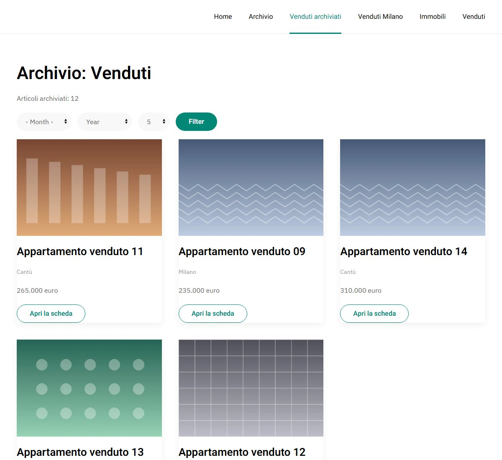
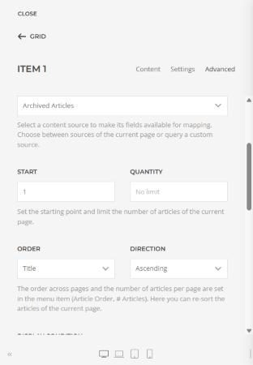
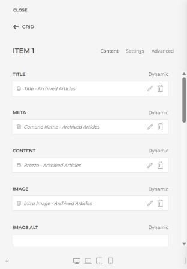

# Archive Layouts for YOOtheme

Joomla system plugin by [WebG](https://www.webg.it), free software under the GNU GPL v2 or later.
Design the Joomla **Archived Articles** page with the **YOOtheme Pro builder**, like category
and featured pages.



**What it does**

- New YOOtheme template type **Archived Articles** for the menu item *Articles > Archived
  Articles*, assignable by category (with child categories), page number and language.
- Dynamic content group **Archive**: the archived articles of the page with every article
  field and **all custom fields**, a single article, and archive information (count, page,
  filtered month and year, ready-made filter form). Works with the YOOtheme Pagination element.
- Since 2.0 it does only the layout. The archive automation that was part of 1.x is the separate
  plugin [Auto Archive](https://github.com/WebG-it/auto-archive) (see *Updating from 1.x* in the
  [user guide](./docs/yooarchive/USAGE.md#updating-from-1x)).
- Survives YOOtheme updates (nothing is written in the template folder). English and Italian.

**Requirements**: Joomla 5 or 6, PHP 8.1+, YOOtheme Pro 5. Tested on Joomla 6.2.0 and 5.4.10,
PHP 8.4, YOOtheme Pro 5.0.51, together with Essentials for YOOtheme Pro 3.0.15 and 4SEO 7.2.0
([tested compatibility](./docs/yooarchive/USAGE.md#tested-compatibility)).

**Install**: download `plg_system_yooarchive-2.0.1.zip` from the
[releases](https://github.com/WebG-it/archive-layouts/releases) (or [dist/](./dist)), then
*System > Install > Extensions > Upload Package File*. Full guide: [USAGE.md](./docs/yooarchive/USAGE.md)
(italiano: [USO.md](./docs/yooarchive/USO.md)).

**Updates**: automatic, in *System > Update > Extensions*. The update server of this plugin is
[`collection.xml`](./collection.xml) in this repository
(`https://raw.githubusercontent.com/WebG-it/archive-layouts/main/collection.xml`), which points to [`updates/yooarchive.xml`](./updates/yooarchive.xml).
Until 2.0.0 the plugin used the shared WebG collection of
[joomla-extensions](https://github.com/WebG-it/joomla-extensions); version 2.0.1 moves it here, and
sites that still use the old address are offered 2.0.1 there.

| Builder: dynamic source | Builder: custom fields |
|---|---|
|  |  |

## Repository

```
plugins/plg_system_yooarchive/   plugin source
dist/                            installable zips (one per released version)
collection.xml                   update server of this plugin (one row)
updates/yooarchive.xml           its details: version, download, sha256
changelogs/yooarchive.xml        changelog feed shown by Joomla
build/release-notes/             text of each GitHub release
docs/yooarchive/                 user guide (USAGE, USO) and developer guide (DEVELOPING)
```

Build script, Docker test sites (Joomla 5 and 6) and JED Checker helpers are shared by all WebG
plugins and live in [joomla-dev-tools](https://github.com/WebG-it/joomla-dev-tools): not copied here.
A new version always changes the version number: two different zips never share one.

Support: [GitHub issues](https://github.com/WebG-it/archive-layouts/issues) (write your Joomla,
PHP and template versions; never post passwords, keys or private data).

License: GNU GPL v2 or later. YOOtheme Pro is a separate commercial product of YOOtheme GmbH and
is not included.
